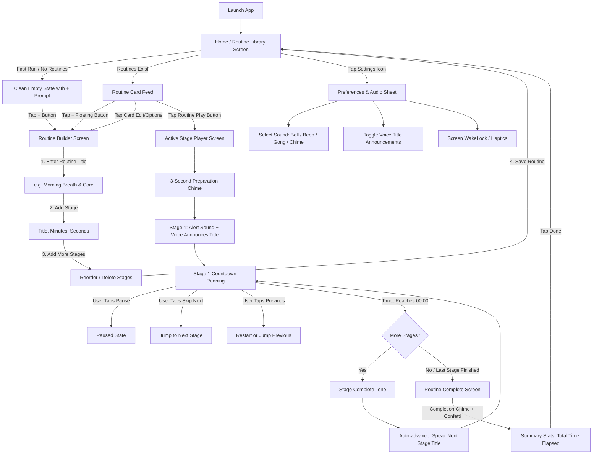

# FlowTimer — Comprehensive Design Specification & System Document (DESIGN.md)

> **Document Purpose**: This document outlines the complete vision, architecture, user flows, design tokens, component specifications, and screen-by-screen prompts for **FlowTimer**. It is structured specifically to be provided to **Stitch** (or UI design tools) to generate a bespoke, high-craft mobile interface that avoids generic "AI-generated" aesthetics.

---

## 1. Executive Summary & Core Value Proposition

### 1.1 The Problem
When performing structured activities—such as multi-stage meditation, breathwork, high-intensity interval training (HIIT), yoga, study sprints (Pomodoro), or multi-step cooking—users cannot and should not look at or touch their smartphone to set successive timers. Doing so breaks focus, ruins posture, interrupts physical exertion, or breaks meditative flow.

### 1.2 The Solution
**FlowTimer** is a tactile, sequential, hands-free routine timer. The user configures a routine with multiple distinct stages (each with its own label and duration). When started, FlowTimer:
1. Gives an optional brief prep countdown.
2. Plays a distinctive acoustic alert.
3. Speaks the name of the stage out loud via Text-to-Speech (TTS).
4. Counts down smoothly.
5. Automatically transitions to the next stage upon completion, chiming and announcing the new stage title without requiring a single tap or glance.
6. Announces routine completion when the final stage ends.

### 1.3 Key Tenet: Universal Versatility
FlowTimer is **not** exclusively a meditation app. It is a universal routine engine equally suited for:
- **Athletics & Fitness**: Warmup (3m) → Sprint (45s) → Rest (30s) → Sprint (45s) → Cool Down (5m).
- **Mindfulness & Pranayama**: Chanting Om (5m) → Box Breathing (7m) → Silent Awareness (10m).
- **Productivity & Deep Work**: Deep Focus (25m) → Stretch & Hydrate (5m) → Deep Focus (25m).
- **Cooking & Brewing**: Bloom Coffee (45s) → First Pour (1m) → Drawdown (2m).

---

## 2. Design Philosophy & Anti-"AI-Generated" Guidelines

### 2.1 The "Anti-AI Slop" Directives
Many AI-generated mobile designs suffer from predictable tropes that make apps look cheap, generic, and unpolished. This design must explicitly reject those patterns:
- ❌ **NO gratuitous purple/violet glow gradients** on dark backgrounds.
- ❌ **NO heavy, blurry glassmorphism** that degrades legibility.
- ❌ **NO useless decorative dashboard cards** (e.g., "Daily Streak: 0 days", "Calories burned: 0", or fake health rings).
- ❌ **NO cluttered icon soup** where every row has a rainbow-colored circle badge.
- ❌ **NO low-contrast muted text** that cannot be read from 2 meters away.

### 2.2 The Chosen Aesthetic: "Tactile Precision Minimalist"
- **Influences**: Dieter Rams / Braun industrial chronometers, Teenage Engineering hardware UI, and Apple Fitness / Things 3 typographic craftsmanship.
- **Visual Personality**: High-contrast, utilitarian, calm, hyper-legible, confident, and tactile.
- **Glanceability Rule**: When a phone is propped on a desk or yoga mat 2 meters away, the user must be able to read the remaining time and the current stage title in under 100 milliseconds.
- **Surfaces**: Obsidian, deep slate, and pitch blacks (`#090B10`, `#11141E`, `#181D2B`) paired with crisp 1px borders (`rgba(255, 255, 255, 0.08)`) and purposeful accent highlights (such as Amber Gold `#F59E0B`, Electric Emerald `#10B981`, or Crisp Cobalt `#3B82F6`).

---

## 3. Design Tokens & System

### 3.1 Color Palette
| Token Name | Hex Code | Usage |
| :--- | :--- | :--- |
| `bg-base` | `#080A0F` | True dark OLED background; saves battery and prevents glare in dark rooms |
| `bg-surface` | `#111520` | Primary cards, routine list items, sheet surfaces |
| `bg-surface-elevated`| `#192030` | Active states, hover/pressed cards, input backgrounds |
| `border-subtle` | `rgba(255,255,255,0.07)`| Clean 1px structural dividing lines |
| `border-prominent` | `rgba(255,255,255,0.16)`| Selected cards, active inputs, modal headers |
| `text-primary` | `#F8FAFC` | Main headings, countdown timer digits, active stage label |
| `text-secondary` | `#94A3B8` | Stage subtitle, total durations, helper metadata |
| `text-tertiary` | `#64748B` | Inactive elements, placeholders, keyboard shortcuts |
| `accent-primary` | `#F59E0B` | Energetic Warm Amber: primary buttons, active countdown gauge, playing indicator |
| `accent-glow` | `rgba(245,158,11,0.15)` | Subtle, non-invasive active stage indicator background |
| `accent-success` | `#10B981` | Completed stages, routine finished celebration |
| `accent-danger` | `#EF4444` | Delete routine, cancel confirmation |

### 3.2 Typography System
- **Display Numerals (The Countdown Clock)**: Monospace or Tabular Sans (e.g., `Geist Mono`, `JetBrains Mono`, or `SF Pro Rounded` with `tabular-nums`). Size: `64px` to `76px`, `font-bold` (700 or 800), tight letter spacing (`tracking-tight`). Numbers must never jump or jitter during counting.
- **Stage Titles (Active View)**: `24px` – `28px`, `font-semibold`, crisp contrast (`#F8FAFC`).
- **Headings (Screens & Modals)**: `20px` – `22px`, `font-bold`.
- **Body / Metadata**: `14px` – `15px`, `font-normal` or `font-medium`, `#94A3B8`.
- **Chips & Badges**: `11px` – `12px`, `font-mono`, `font-semibold`, uppercase tracking (`tracking-wider`).

### 3.3 Safe Insets & Mobile Geometry
- Mobile portrait viewport: 390px × 844px (standard mobile baseline).
- **Status Bar Safe Inset**: Top padding must strictly include `var(--safe-top, 44px)` to avoid clock/notch collisions.
- **Bottom Navigation Safe Inset**: Bottom padding must strictly include `var(--safe-bottom, 34px)` for gesture pill navigation.
- **Corner Radius**: Cards `16px`, Buttons `12px` or pill `9999px`, Modals top radius `24px`.

---

## 4. Complete Application Architecture & User Flow



---

## 5. Detailed Screen-by-Screen Specifications & Stitch Prompts

Use the following detailed prompts to generate each individual screen in Stitch.

---

### Screen 1: Home / Routine Library (`home_screen`)

#### Purpose
The starting hub. Displays saved custom routines cleanly with one-tap play, total duration, and stage previews. When no routines exist, displays a minimal, inspiring empty state.

#### Key Elements & Layout
1. **Top Header**:
   - Left: FlowTimer wordmark with subtle pulsing dot icon.
   - Right: Quick Settings icon button (gear) + Sound toggle icon.
2. **Hero / Quick Status**:
   - Compact, high-craft header bar showing "Routines (Count)" and total library time.
3. **Empty State (Zero Routines)**:
   - Centered minimal graphic: an elegant outlined hourglass or concentric circular pulse in `#192030`.
   - Title: *"No Routines Created"*.
   - Subtitle: *"Create your first multi-stage sequence for workouts, meditation, or focus sprints."*
   - Large tactile button: `+ Create Your First Routine` (Amber accent, bold text, 14px padding).
4. **Populated State (Routine Cards)**:
   - Each card has:
     - Header: Routine Title (e.g. "Pranayama & Focus", "HIIT Sprint Cycle") in bold white (`18px`).
     - Badge: Total duration (e.g. `22m 00s`) + Stage count (e.g. `4 Stages`).
     - Horizontal Stage Preview Track: Mini pill badges showing each stage in order: `[Om Chanting 5m] → [Breathwork 7m] → [Silence 10m]`.
     - Actions: Big direct **Play (▶)** button with tactile amber border, plus a secondary three-dot menu (Edit / Duplicate / Delete).
5. **Floating Action Button (FAB)**:
   - Bottom right: Generous circular `+` button (`56px × 56px`), amber background (`#F59E0B`), elevated shadow, anchored above the safe-area bottom bar.

#### Stitch Prompt for Screen 1
```text
Mobile app screen: FlowTimer Home / Routine Library.
Theme: Deep obsidian dark mode (#080A0F background) with refined amber (#F59E0B) and slate accents.
Device: Mobile portrait 390x844 with safe-area padding at top and bottom.
Content:
- Header: Minimal clean app bar with "FlowTimer" text in crisp bold typography and a subtle gear icon on the top right.
- Subheader: "Your Routines" with a count badge "(2)".
- Card 1: "Morning Breathing & Core" - 15m 00s total duration badge. Below the title, a horizontal chain of 3 stage pills: "1. Box Breathing 5m", "2. Plank Hold 3m", "3. Deep Stretch 7m". Right side has a circular Amber Play icon button (44x44) and a subtle 3-dot options icon.
- Card 2: "Deep Focus Sprint" - 30m 00s total. Stage pills: "1. Ideation 5m", "2. Deep Writing 20m", "3. Review 5m".
- Bottom right: Prominent elevated amber circular Floating Action Button with a crisp white plus (+) icon.
Style: Industrial minimalist, high-contrast, razor-sharp 1px border lines (rgba(255,255,255,0.08)), tabular fonts for times, zero generic purple gradients or blurry glassmorphism.
```

---

### Screen 2: Routine Builder / Stage Editor (`routine_builder_screen`)

#### Purpose
Create or edit a multi-stage sequence. Simple, frictionless, and fast. The user names the routine and adds stages one after another with clear title and duration inputs.

#### Key Elements & Layout
1. **Navigation Bar**:
   - Left: "Cancel" button.
   - Center: "New Routine" or "Edit Routine".
   - Right: "Save" button (Amber highlight, disabled if no stages exist).
2. **Routine Details Section**:
   - Input Field: Routine Name (e.g., "HIIT Intervals", "Evening Wind Down") with dark slate background, crisp border on focus.
3. **Stage Sequence List (Dynamic Items)**:
   - Each stage card shows:
     - Drag handle (grip icon) on left for reordering.
     - Stage number badge (`1`, `2`, `3`).
     - Stage Name Input (e.g., "Warmup", "Chanting Om", "Sprint", "Rest").
     - Duration Picker / Stepper: Separate Minutes and Seconds selectors with fast quick-add chips (`+30s`, `+1m`, `+5m`).
     - Delete stage button (subtle trash icon).
4. **Quick Stage Name Suggestions**:
   - Row of horizontal scrollable suggestion chips: `[Work]`, `[Rest]`, `[Warmup]`, `[Focus]`, `[Chanting]`, `[Breath]`, `[Cool Down]`.
5. **Add Stage Action**:
   - Prominent dashed-border button: `+ Add Next Stage`.
6. **Bottom Sticky Summary**:
   - Floating footer displaying: `Total Sequence Time: 18m 30s` (auto-calculates as stages are adjusted).

#### Stitch Prompt for Screen 2
```text
Mobile app screen: FlowTimer Routine Builder / Editor.
Theme: Deep dark slate (#080A0F) with refined amber (#F59E0B) accents.
Device: Mobile portrait 390x844 with safe-area padding.
Content:
- Top bar: "Cancel" on left, "New Routine" title in center, "Save Routine" highlighted button on right.
- Input field: "Routine Title" with placeholder "e.g., HIIT Sprint Interval" inside a clean 1px bordered dark card (#111520).
- Section Header: "Stages Sequence" with subtitle "Stages run back-to-back with voice announcements".
- Stage Item 1 card: Shows drag handle, "Stage 1", text input with "Warmup Jog", duration selector showing "03:00" with small "+1m" "+30s" chips, and a remove icon.
- Stage Item 2 card: "Stage 2", text input with "All-Out Sprint", duration "01:00", active accent border.
- Stage Item 3 card: "Stage 3", text input with "Active Recovery", duration "02:00".
- Suggestion chips row: Pill buttons for "Work", "Rest", "Focus", "Stretch", "Cooldown".
- Button: Large dashed border button "+ Add Another Stage".
- Bottom bar: Fixed summary bar showing "Total Duration: 06:00 (3 stages)".
Style: Precise, tactile typography, clean inputs with high contrast text, no decorative fluff.
```

---

### Screen 3: Active Stage Player (`active_player_screen`) — The Hero Experience

#### Purpose
The primary experience when a routine is executing. Designed to be placed across the room and understood in a fraction of a second. Delivers audio alerts and TTS announcements seamlessly.

#### Key Elements & Layout
1. **Top Status Bar & Insets**:
   - Full safe-area spacing at top.
   - Left: Close / Exit button (✕) with confirmation dialog to prevent accidental cancellation.
   - Center: Current Routine Title ("Morning Breath & Core") in subdued metadata text.
   - Right: Audio / Voice Mute toggle icon + Screen WakeLock indicator icon.
2. **Stage Progression Horizon (Timeline)**:
   - Segmented progress bar across the top displaying all stages as connected steps. Completed steps turn solid green/amber, current step pulses gently, upcoming steps are muted gray.
   - Small stage indicator: `Stage 2 of 4`.
3. **Current Stage Name (Super-sized)**:
   - Giant, crisp text: **"BOX BREATHING"** (or "ALL-OUT SPRINT").
   - Subtitle: *"Next: Plank Hold (03:00)"* with small arrow icon, giving immediate awareness of what follows.
4. **Primary Countdown Clock (Glanceable from 2+ meters)**:
   - Giant circular progress ring or minimalist radial gauge.
   - Massive Tabular Numbers: `04:18` (Minutes : Seconds).
   - Under the numbers: Mini milliseconds ticker or subtle visual breathing ring.
5. **Audio State Notification Banner (Micro-banner)**:
   - Subtle pill badge: `🔊 Announced: "Box Breathing"` that appears for 2 seconds when a stage begins, showing that TTS spoke the title.
6. **Tactile Player Controls**:
   - Bottom dock with generous tap targets:
     - Left: Previous Stage (`⏮`) button.
     - Center: Giant tactile **Pause / Resume** button (`72px × 72px`) in vibrant Amber Gold with high-contrast icon.
     - Right: Next / Skip Stage (`⏭`) button.
     - Secondary below: Reset Current Stage (`↺`) and Total Elapsed Time (`Total: 07:42 / 15:00`).

#### Stitch Prompt for Screen 3
```text
Mobile app screen: FlowTimer Active Player Screen (Running Countdown).
Theme: Deep pitch black (#080A0F) optimized for OLED, zero glare, high contrast.
Device: Mobile portrait 390x844, safe status bar space at top.
Content:
- Top bar: Dismiss (X) icon on top left, "Morning Breath & Core" in small caps center, sound volume icon on top right.
- Progress track: Segmented horizontal bar showing 4 stages (Stage 1 filled, Stage 2 active with amber glow, Stages 3 & 4 dark gray).
- Stage Metadata: "STAGE 2 OF 4" in tracking-wider mono text.
- Active Stage Name: "BOX BREATHING" in massive, bold, crisp white typography (32px).
- "Next: Plank Hold (3:00)" in muted slate text with right arrow.
- Center Hero: Large circular minimalist countdown ring with amber progress arc. Inside the ring, massive timer digits: "04:18" in tabular mono bold font (72px), ultra-crisp and legible from 2 meters away.
- Bottom Controls: Balanced horizontal bar with 3 tactile buttons:
  - Rewind/Previous Stage (circle 48x48)
  - Giant Center Play/Pause button (circle 76x76, filled amber #F59E0B with black pause icon)
  - Fast-forward/Skip Stage (circle 48x48)
- Bottom footer text: "Total Elapsed: 07:18 / 15:00 • Audio: Clear Bell + Voice".
Style: High-end sports chronometer meets calm mindfulness timer. Crisp borders, zero blurry purple gradients, extreme legibility.
```

---

### Screen 4: Routine Complete Celebration (`routine_complete_screen`)

#### Purpose
Reward the user upon completing all stages. Provides a brief celebration chime and summary without trapping them in endless post-workout surveys.

#### Key Elements & Layout
1. **Hero Badge**:
   - Minimalist geometric success checkmark or laurel icon in soft emerald green (`#10B981`).
2. **Celebration Headline**:
   - "Routine Complete!"
   - Routine Title: *"Morning Breath & Core Finished"*.
3. **Summary Stats Bento Grid**:
   - Tile 1: **Total Time** (e.g. `15m 00s`).
   - Tile 2: **Stages Completed** (e.g. `4 / 4 Stages`).
   - Tile 3: **Completed At** (e.g. `7:45 AM`).
4. **Primary Action**:
   - Full-width tactile button: `Back to Routines` or `Repeat Routine`.

#### Stitch Prompt for Screen 4
```text
Mobile app screen: FlowTimer Routine Complete Summary.
Theme: Deep dark slate (#080A0F) with emerald green (#10B981) and amber accents.
Device: Mobile portrait 390x844.
Content:
- Center Icon: Minimalist circular emerald badge with clean white checkmark.
- Heading: "Routine Complete!" in 28px bold white text.
- Subtitle: "Great job completing Morning Breath & Core".
- Bento Summary Grid (2x2 cards):
  - Card 1: "Total Time" -> "15:00" in bold mono digits.
  - Card 2: "Stages Done" -> "4 of 4" with green dot.
  - Card 3: "Average Stage" -> "3m 45s".
  - Card 4: "Sound Alerts" -> "Active".
- Bottom Button: Full width primary button "Done & Return Home" (amber #F59E0B, 16px font, rounded-xl).
- Secondary Text Button: "Run Routine Again".
Style: Clean, calm accomplishment feel, no noisy clutter or fake badges.
```

---

### Screen 5: Settings & Audio Preferences Sheet (`settings_sheet`)

#### Purpose
Allow users to select their chime sound, adjust TTS speech rate, toggle screen wake-lock, and manage routine data.

#### Key Elements & Layout
1. **Header**: "Settings & Preferences" with drag indicator pill.
2. **Audio Alert Section**:
   - Sound Picker (Segmented radio or cards with play preview button):
     - `Clear Bell` (Resonant singing bowl tone)
     - `Digital Beep` (Crisp dual-tone athletic beep)
     - `Warm Chime` (Soft marimba chime)
     - `Deep Gong` (Low resonant gong)
     - `Silent` (Haptic vibration only)
3. **Voice Announcement (TTS) Section**:
   - Toggle: `Speak Stage Titles Aloud` (On/Off).
   - Speed Slider: Speech rate (`0.8x`, `1.0x Normal`, `1.2x Faster`).
   - Preview Button: "Test Voice ("Starting Next Stage")".
4. **App Behavior Section**:
   - Toggle: `Keep Screen Awake While Timer is Running` (Prevents phone from sleeping).
   - Toggle: `Vibrate on Stage Transition`.
   - Button: `Clear All Routines` (with confirmation modal).

#### Stitch Prompt for Screen 5
```text
Mobile app screen: FlowTimer Settings & Audio Sheet.
Theme: Deep dark modal card (#111520) sliding up over dark backdrop.
Device: Mobile portrait 390x844.
Content:
- Top: Drag handle pill bar and title "Sound & Behavior Preferences".
- Section 1: "Alert Sound" with 4 selectable radio rows: "Clear Bell" (checked), "Digital Beep", "Warm Chime", "Deep Gong". Each row has a small play preview speaker icon on the right.
- Section 2: "Voice Announcements (TTS)" with toggle switch set to ON. Explanatory text: "Speaks the title of each stage when it starts".
- Slider: "Speech Rate" with markers 0.8x, 1.0x, 1.2x.
- Section 3: "Display & System":
  - Row with switch: "Keep Screen Awake (WakeLock)" -> ON.
  - Row with switch: "Haptic Vibration on Transition" -> ON.
- Danger zone: "Clear All Routines" in subtle red text.
Style: High-craft system settings sheet, iOS/Android native premium feel, clean divider lines.
```

---

## 6. How to Use This Document with Stitch

1. **Upload or Paste**: Open your Stitch workspace and provide this `DESIGN.md` file (or copy the individual screen prompts from Section 5).
2. **Generate Screen by Screen**: Start with **Screen 3 (Active Player)** and **Screen 1 (Home)** first to establish the primary visual language and component rhythm.
3. **Review Against the Anti-AI Checklist**:
   - Are the timer digits giant, monospaced, and easy to read from 2 meters away?
   - Is the background a true deep dark slate/obsidian rather than generic violet gradients?
   - Are the stage transitions clearly visualized via a segmented timeline?
4. **Bring Back the Result**: Once you are happy with the visual screens generated in Stitch, share the design tokens, layout structure, or component styling here, and we will translate them directly into the clean React + Tailwind codebase!
